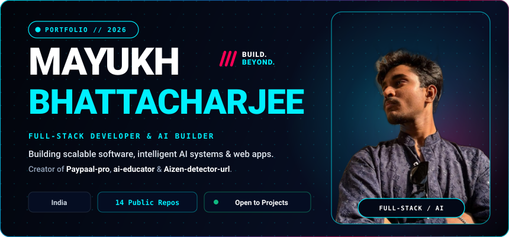
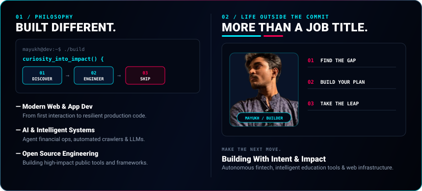
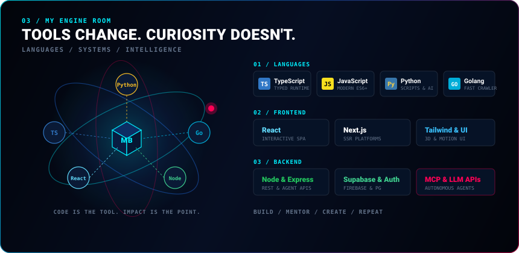
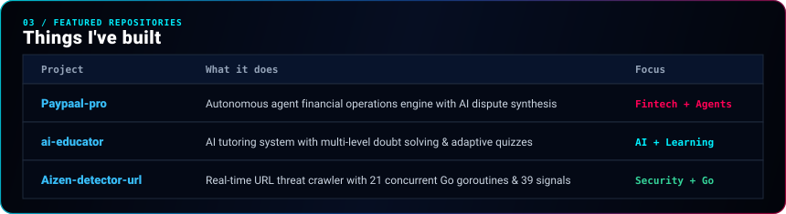
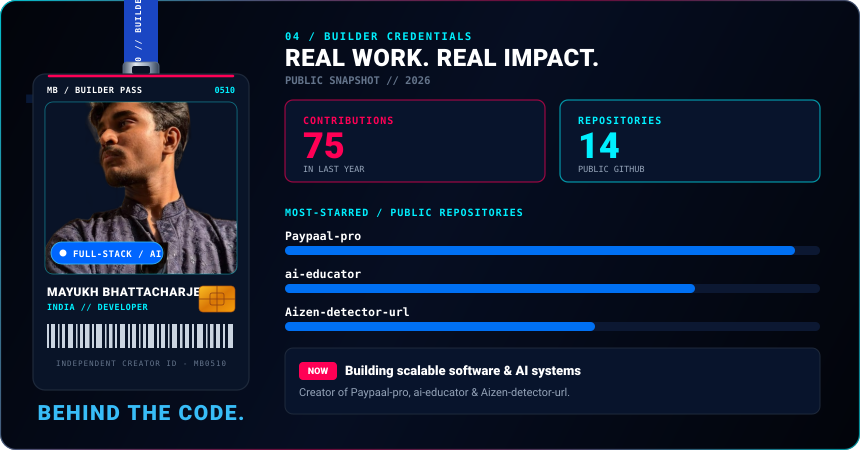
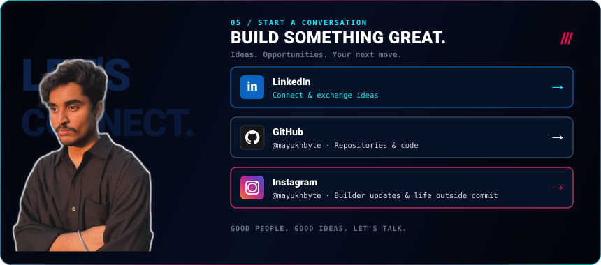

 

 

 

 

 

 

### 🌐 Let's Connect

 
 

Curious by default. Building with intent. · Designed &amp; Maintained by <b>Mayukh Bhattacharjee</b> (<a href="https://github.com/mayukhbyte">@mayukhbyte</a>)

